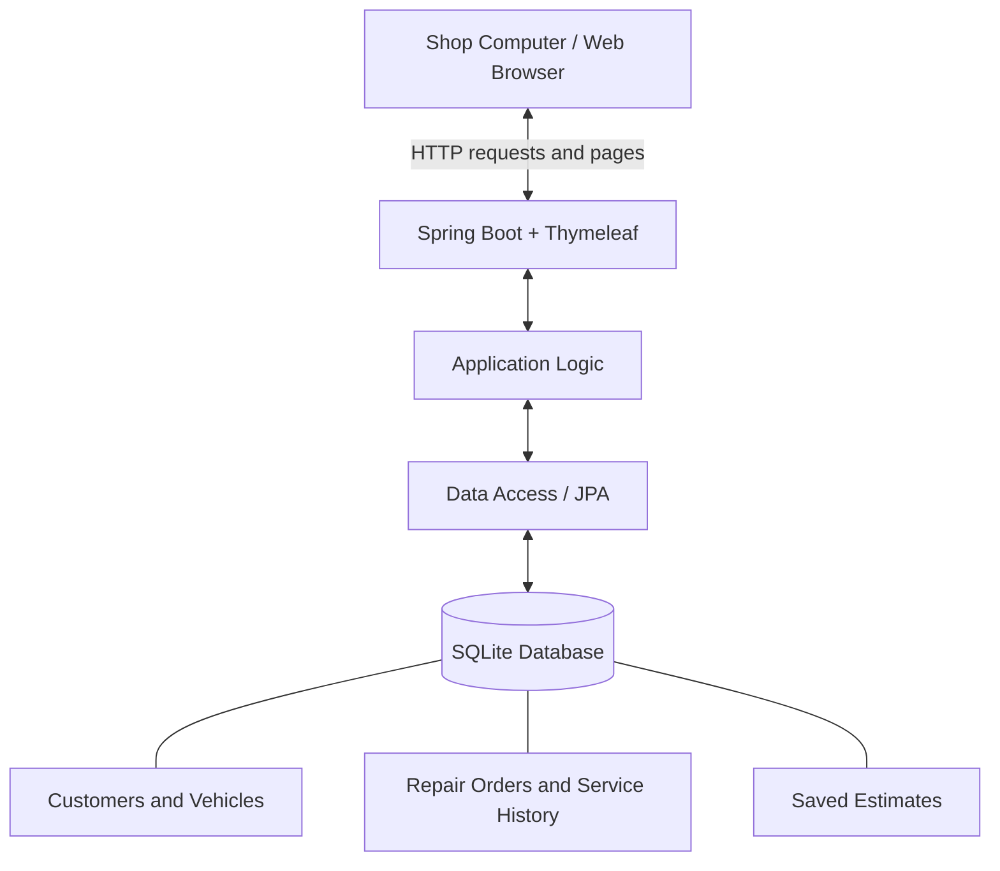

Bailey Auto Repair & Customization — Shop Management System
CMP 464/343 — Product 1: Personal Software Specification
Author: Sharaf Masoud
Project type: Java-based web application
Status: Product specification / proposed MVP
1. About Me: The Problem in My Life
I help run Bailey Auto Repair & Customization, where customer contact details, vehicle information, repair orders, and estimates are currently recorded on paper. I need to retrieve that information while customers are waiting, vehicles are being serviced, and past work needs to be checked. Missing records and inaccurate estimates have already cost my shop time and money.
Three real incidents
When	What happened	Impact
Friday, October 30, 2026	I could not find a customer's contact information, so I could not arrange for the customer to pick up their vehicle. The vehicle occupied a parking space for an extra day.	$75 in storage/parking fees and one day of delay.
Monday, October 26, 2026	A customer returned because a previously installed part had failed. I could not find the original repair order to verify warranty coverage, and the shop replaced the part at its own expense.	$175 for the replacement part and three hours of labor.
Tuesday, October 27, 2026	I gave a customer a repair estimate that turned out to be too low because the vehicle needed more work than originally quoted.	$75 in reported cost and one hour of time.

Documented impact: At least $325 in reported direct costs ($75 + $175 + $75), plus one full day of delay and four hours of work. The monetary value of the three labor hours in the second incident has not been separately calculated, so I have not added it to the $325 total. These incidents were frustrating because they interrupted shop operations, created avoidable expenses, and made it harder to provide reliable service to customers.
2. Problem Statement
Gut check
I need a reliable and affordable way to organize customer information, vehicle repair history, and estimates because missing paperwork and incorrect information are costing my business time and money.
Five Whys
1. Why is managing customer information, repair orders, and estimates difficult? Because I rely on handwritten paperwork that sometimes gets lost or misplaced.
2. Why do I still rely on handwritten paperwork? Because existing automotive shop management software is too expensive for my business.
3. Why is existing software too expensive? Because the monthly subscription fees are too high for my shop's budget.
4. Why is it difficult to justify paying a monthly subscription? Because I must prioritize rent, parts, equipment, and employee wages.
5. Why haven't I found an affordable alternative? Because I haven't found an affordable or free option that reliably handles customer records, repair history, and estimates.
Root cause
My shop depends on handwritten records because I have not found an affordable, reliable alternative that meets its basic needs. Paper records can be misplaced, making it difficult to retrieve customer information and previous repairs when needed. Inaccurate estimates are another costly shop problem that I want to address, although the exact cause of the October 27 underestimate has not yet been established.
Solution-free problem statement
When customers bring vehicles to Bailey Auto Repair & Customization or return with questions about previous repairs, I struggle to quickly find their contact details and service history. I also need to prepare estimates accurately enough to avoid unexpected losses. Across three recent incidents, these problems caused at least $325 in reported costs, one day of delay, and four hours of work. I currently depend on handwritten records, and the subscription prices of existing automotive management systems are difficult to justify alongside essential shop expenses.
I'll know this is solved when
- I can locate a customer's contact information and previous repair history in under 30 seconds during a timed test.
- I can create and save a basic parts-and-labor estimate in under five minutes during a timed test.
- I can go 30 consecutive days without a missing repair order or an expense caused by missing customer contact records.
These are proposed success targets, not results already achieved. I will test them using sample records first and measure them during actual shop use only after the system is safe and ready.
3. Existing Solutions
What I use or have considered	What works	Why it falls short
Paper and handwritten repair orders (currently used)	Familiar, inexpensive, and quick to start writing.	Records can be lost or misplaced; searching past work and customer details takes time.
Automotive shop management software (considered as a category, not personally tested)	Such systems can organize customer records, service history, and estimates.	Monthly subscription costs are difficult to fit into my shop's budget.

The gap
I need an affordable, reliable, and easy-to-use way to manage customer information, vehicle repair history, repair orders, and estimates without a high recurring subscription cost. I have not claimed to have tried specific commercial software products.
4. Features & Benefits
Feature	Benefit to me and the shop	Priority
Customer & Vehicle Database — Add, edit, and search customers; connect vehicles by year, make, model, and optionally VIN.	I can find customer phone numbers and vehicle details quickly, reducing pickup delays and time spent searching for paperwork.	MVP
Repair Orders & Service History — Create repair orders linked to a vehicle; record work, parts, labor, and completion details; retrieve past orders.	I can verify previous work and avoid missing service records when a customer returns.	MVP
Repair Estimate Calculator — Enter parts costs, labor hours, and an hourly labor rate; calculate and save an estimate.	I can produce more consistent estimates and reduce arithmetic errors. It will not automatically detect hidden mechanical problems or guarantee a final quote.	MVP
Repair Status Management — Mark a vehicle waiting, in progress, or ready for pickup.	I can see which vehicles need attention.	Later
Parts Warranty Records — Record part warranties and coverage details.	I can check warranty terms more easily when parts fail.	Later
Appointment Scheduling — Organize upcoming bookings.	I can plan shop workload.	Later

MVP scope
For the first version, I will build only the three MVP features above. The basic workflow is: create or find a customer → select or add their vehicle → create a repair order → add parts and labor → save an estimate → retrieve the order later.
Not doing in the first version
- Online payments or credit card processing
- Payroll and employee timekeeping
- Automatic parts ordering
- Inventory management
- Customer-facing mobile application
- Advanced accounting reports and integrations
Keeping these out of scope should make the project more realistic to complete in approximately four weeks.
5. Tech Stack & Architecture
I want a web application that I can use primarily from a browser on my shop computer. Since Java is the language I know best, I will use a Java backend and a simple server-rendered interface rather than learning a large JavaScript framework for the first version.
Layer	Choice	Reason
Front end	HTML, CSS, Thymeleaf	A simple browser interface; Thymeleaf can render pages from Java data.
Back end	Java + Spring Boot	Java is my strongest language, and Spring Boot provides a structure for web requests and application logic.
Data access	Spring Data JPA / Hibernate	Helps connect Java objects to stored database records.
Database	SQLite	Free, lightweight, and practical for a single-computer prototype.
Hosting	Local shop computer (localhost)	No monthly hosting bill for the MVP; the application runs while the local server is on.
External services	None for MVP	Avoids extra costs and integration work.

Architecture sketch

How the parts work together
1. I open the application in a browser on my shop computer.
2. The HTML/Thymeleaf pages let me search for a customer, add a vehicle, create a repair order, or enter estimate details.
3. Spring Boot validates the inputs and performs calculations, such as parts subtotal + (labor hours × hourly labor rate). Taxes and extra fees are not included until their rules are decided.
4. The data-access layer saves or retrieves records from SQLite.
5. The application displays the saved customer, repair history, or estimate in the browser.
Practical limitation: A local-only application will not automatically be available from my phone or outside the shop. Before storing real customer information, I need to decide how to secure access and back up the database. The exact Spring Boot–SQLite configuration also needs to be tested early because it requires a compatible SQLite JDBC driver and Hibernate dialect.
Proposed four-week build sequence
Week	Goal
1	Set up the Spring Boot project, SQLite connection, and customer/vehicle forms.
2	Create and retrieve repair orders linked to vehicles.
3	Add estimate calculations and saved estimates.
4	Test realistic shop workflows, fix bugs, and document setup and limitations.

6. Open Questions
These questions remain unresolved and should be answered before or during development:
1. Required fields: Must each customer have a name and phone number? Which vehicle details are mandatory, and is VIN optional?
2. Repair order workflow: What fields must a repair order contain, and how will completed orders be distinguished from active ones?
3. Estimate rules: Should estimates include sales tax, shop fees, discounts, or multiple labor rates? How should estimates be revised when additional work is discovered?
4. Privacy and backups: Who can access customer data, and how often will the SQLite database be backed up?
5. Success testing: How many sample customers and repair orders should I use when timing searches and estimates?
Project Boundaries
This README is a product specification, not a claim that the application has already been built. The MVP is intended for a small, primarily single-computer shop workflow. Features listed as “Later” and unresolved questions are not part of the committed first release.
